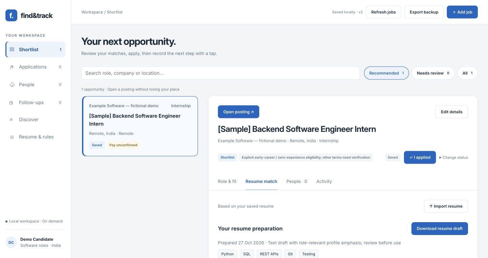

# Find&Track

A local-first, open-source workspace for finding software jobs and tracking what happens next.

I built this during my own job search in India: openings, resume versions, recruiter links and follow-ups were scattered across tabs. Find&Track brings that workflow into one workspace. **v0.4.0 is an early release**, focused on India and early-career software roles. Contributions and ideas are welcome.



## Start in five minutes

Requires Python 3.11 or newer. Node.js is only needed to run frontend tests.

```sh
git clone https://github.com/anubhav1450/find-and-track.git
cd find-and-track
python3 -m venv .venv
.venv/bin/python -m pip install -r requirements.txt
.venv/bin/python outputs/find-track-app/launch.py
```

On Windows, replace `.venv/bin/python` with `.venv\Scripts\python.exe` and use `python` to create the environment. Open http://127.0.0.1:8765/. Keep the folder: your workspace is saved there. Run the last command again after restarting your computer. If the port is busy, add `--port 8766`.

1. **Import your resume** under Resume & rules, then review the extracted text and role/location preferences.
2. **Refresh jobs** to read supported employer feeds. Optionally connect your own Tavily key under Discover → Connect search for role-based web discovery.
3. **Paste a posting link** into Add job → Import posting. Review the extracted details before saving.
4. **Review company evidence and people**, open the original posting and apply yourself.
5. **Tap I applied**, record connection/message progress and keep follow-ups alongside the role.

A fresh installation is empty. No ChatGPT, Claude or Alan subscription is required. Core tracking and employer feeds work without a search key. The hosted owner workspace is not a public multi-user service; install your own copy using the commands above.

## What works today

| Workflow | What to expect |
| --- | --- |
| Job discovery | Selected Greenhouse, Lever and Ashby employer feeds, Remotive, and optional role-based Tavily search |
| Freshness | Source publication dates separate from first discovery; current leads and date filters; source errors remain visible |
| Link import | Supported ATS postings read from public APIs; other indexed links are unconfirmed leads for review |
| Resume preparation | Keyword matches, gaps and evidence-based suggestions; reviewed checklist coverage is not an ATS score |
| Company research | Source-linked identity and concern checks, without a guarantee of legitimacy |
| People | Relevant recruiter/employee profile leads, deduplicated with source links; current employment/activity needs confirmation |
| Tracking | One-tap application/contact states, follow-up tasks, CSV export and JSON backup/restore |

Discovery does not cover every portal or guarantee new matches each day. Search-index timestamps are not proof of posting dates. Ten relevant people is a research target, not ten guaranteed active HR contacts. Gmail OAuth/background monitoring, automatic applications and automated LinkedIn outreach are not implemented.

## Optional search and privacy

Bring your own [Tavily](https://app.tavily.com/) key; provider free allowances and terms apply. Keep pay-as-you-go disabled if you want free-only usage. An uncached role search uses up to 3 basic searches, company research up to 12, and an unsupported posting lookup 1. Identical queries are cached for six hours.

The local app limits requests to 900 per UTC calendar month per key/cache installation. This is an attempted-request counter, not the provider's billing ledger. Other apps, deleted caches or separate installations can consume additional credits; ephemeral hosted caches cannot enforce an account-wide limit.

Resume files are processed locally. Search sends role/location preferences, company names or posting URLs to Tavily, not your full resume/contact details. Keys, resumes, databases and exported backups must remain private. See [security and data handling](SECURITY.md).

## Architecture

```text
Browser dashboard → Python HTTP API → local SQLite workspace
                         ├─ resume parser and matching rules
                         ├─ public employer feed adapters
                         └─ optional Tavily discovery/company research
```

Vanilla JavaScript keeps the UI lightweight. Python handles validation, imports, discovery and revision-aware persistence. The optional cloud adapter uses Supabase authentication/storage; it is an owner-only deployment. [Architecture](docs/ARCHITECTURE.md) · [App guide](outputs/find-track-app/README.md) · [Self-hosting](DEPLOYMENT.md)

## Help shape the project

[Report a bug or propose an idea](https://github.com/anubhav1450/find-and-track/issues/new/choose). Especially welcome: fresher-job matching, documented source adapters, accessibility, installation feedback and freshness verification. Use fictional fixtures and public job links; do not post your resume or API key.

[Contributing](CONTRIBUTING.md) · [Roadmap](docs/ROADMAP.md) · [Changelog](CHANGELOG.md) · [Discovery design](docs/DISCOVERY_V02.md)

MIT licensed; bundled Inter font is OFL licensed. [License](LICENSE) · [Font license](outputs/find-track-app/static/Inter-OFL.txt)
