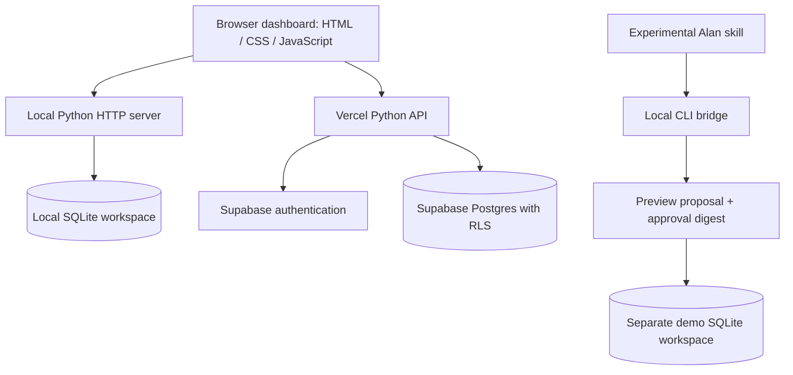

# Find&Track

**A personal job-search workspace — open-source, in progress.**

I built this while applying for early-career software roles. Finding eligible jobs, comparing a JD with my resume, locating recruiters and remembering follow-ups meant jumping between job portals, chat, email and spreadsheets. Find&Track keeps the next action beside the opportunity, so the workflow feels closer to **review → apply → tap → follow up**.

This is a working personal prototype, not a finished job aggregator or an autonomous application service.

See [submission notes](SUBMISSION.md) for the demonstration story and review links.

## What works today

- A dashboard with job links, eligibility notes, compensation uncertainty and application progress.
- Resume import (PDF, DOCX or text), profile rules and a provisional keyword comparison with a job description. Suggested additions must reflect skills you actually know; the percentage is not an ATS score.
- Recruiter profile links and company-level contacts where researched. Coverage is incomplete; a company contact is not necessarily the recruiter for that vacancy.
- Next actions and follow-up drafts, with applications, connections and sending kept under the user's control.
- Local SQLite persistence, plus a private hosted deployment using Vercel and Supabase authentication and database policies.
- An isolated fictional demo and an approval-aware command-line bridge for an experimental Alan skill.

## Try the safe demo

Requires Python 3 and a modern browser; no model subscription or cloud account is needed for the local sample.

```sh
python3 tools/findtrack.py demo
python3 tools/findtrack.py preview --job examples/alan-demo/job.json
python3 tools/findtrack.py serve
```

Open **http://127.0.0.1:8766**. The sample profile and job are fictional. Previewing does not save the job: review the output and use the returned proposal file and approval digest as described in [the companion guide](ALAN_COMPANION.md). The demo stores its own data separately from personal records.

For your own empty workspace:

```sh
python3 outputs/find-track-app/launch.py
```

Open **http://127.0.0.1:8765**, import your resume under **Resume & rules**, then add jobs. PDF import needs the packages in [requirements.txt](requirements.txt). See [the app guide](outputs/find-track-app/README.md) and [deployment guide](DEPLOYMENT.md).

## Architecture



The local and hosted runtimes share application logic. The local bridge checks duplicates, profile changes and proposal integrity before saving an approved record. A new saved job is never silently marked Applied. The Alan bridge currently targets local execution; it is not a hosted multi-user connector.

## Why an Alan skill?

The next experiment is to let Alan handle research and reasoning while Find&Track provides a persistent, reviewable workspace. The intended sequence is **profile → research or pasted JD → assessment → preview → user approval → save**.

The [skill source](skills/find-track/SKILL.md) and bridge are implemented. The skill was installed and enabled in Alan, and the local preview/save/dashboard flow was verified independently. **An end-to-end Alan model run has not succeeded:** the attempted run was blocked by the account's unavailable managed-model allowance. Installation and local tests are not presented as proof of a successful agent run.

See [ALAN_COMPANION.md](ALAN_COMPANION.md) for setup, exact commands and boundaries. This experiment may change as we receive feedback from Alan. The standalone tracker remains usable without it.

## Current limits and next steps

| Area | Current state |
| --- | --- |
| Job discovery | One on-demand public employer feed; broader discovery is assisted research. No claim to cover every portal. |
| Recruiter discovery | Partial researched links; no automatic LinkedIn scraping, connecting or messaging. |
| Resume comparison | Keyword-based guidance that needs human review, not a hiring prediction. |
| Gmail | Imported email batches can be matched; automatic mailbox monitoring is not connected. |
| Shared use | Local demo is reproducible; the hosted personal deployment is owner-only, not public SaaS. |
| Alan | Skill installed; local bridge tested; successful model invocation still pending. |

Next priorities are reliable link-to-job import, broader permitted employer feeds, clearer contact coverage and a verified Alan session before deeper automation.

## Privacy and verification

Personal resumes, inbox batches, application history, databases and research outputs are excluded from version control. The sample data under `examples/alan-demo/` is fictional. Never commit your own data, credentials or environment files. The personal prototype checkpoint is preserved at tag `personal-prototype-2026-10-27`.

```sh
python3 -m unittest discover -s outputs/find-track-app/tests -v
node --test outputs/find-track-app/tests/domain.test.cjs outputs/find-track-app/tests/render.test.cjs
```

## License

MIT — see [LICENSE](LICENSE). Bundled Inter font retains its [OFL license](outputs/find-track-app/static/Inter-OFL.txt).
