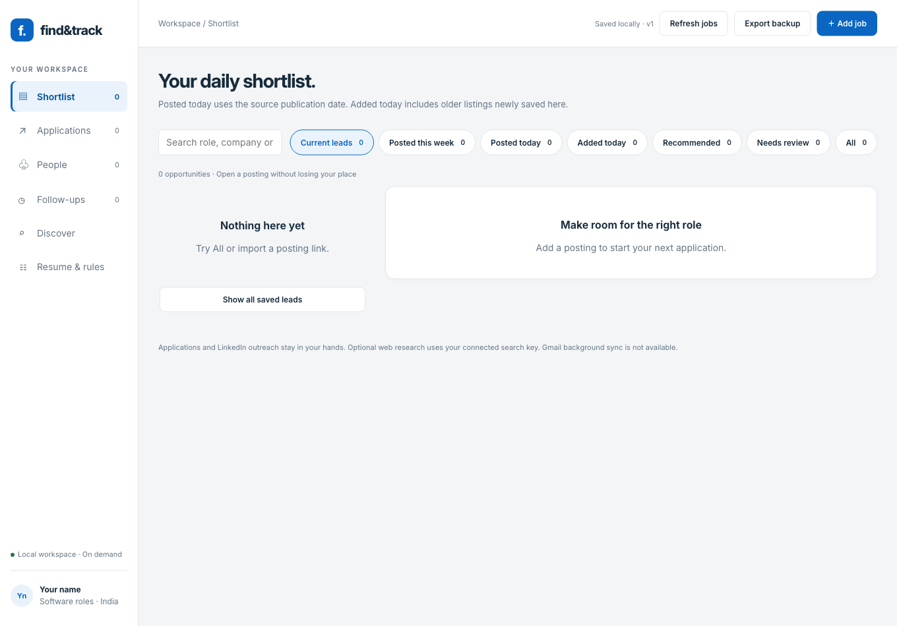
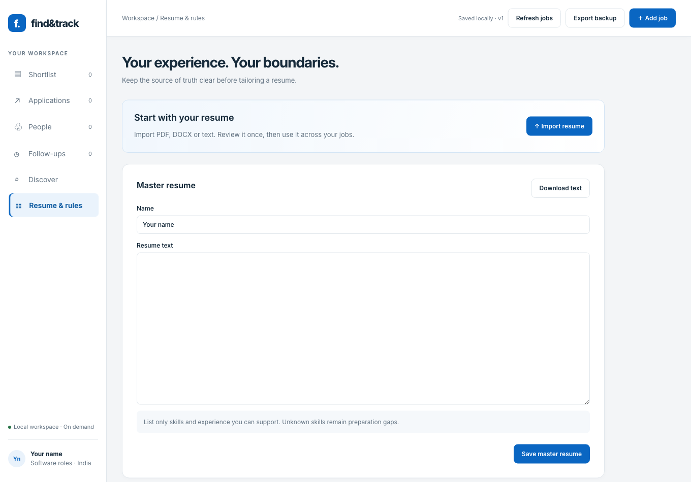
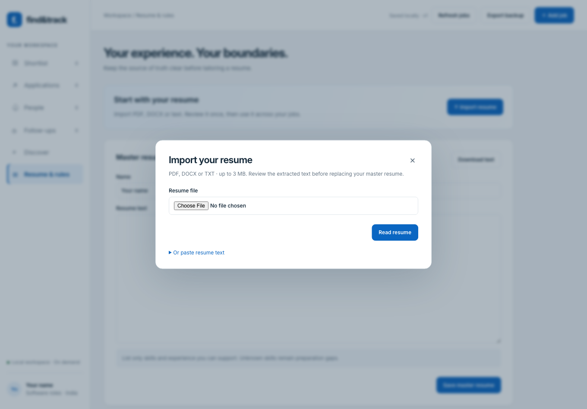
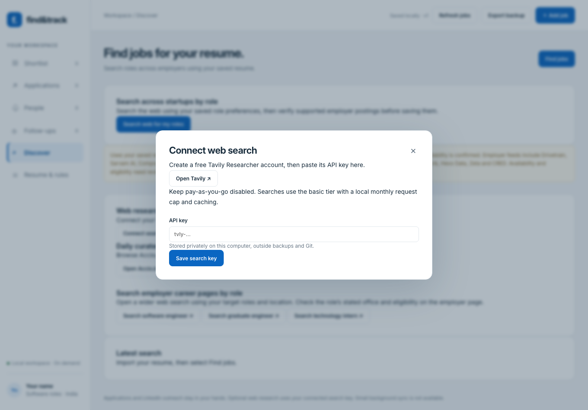
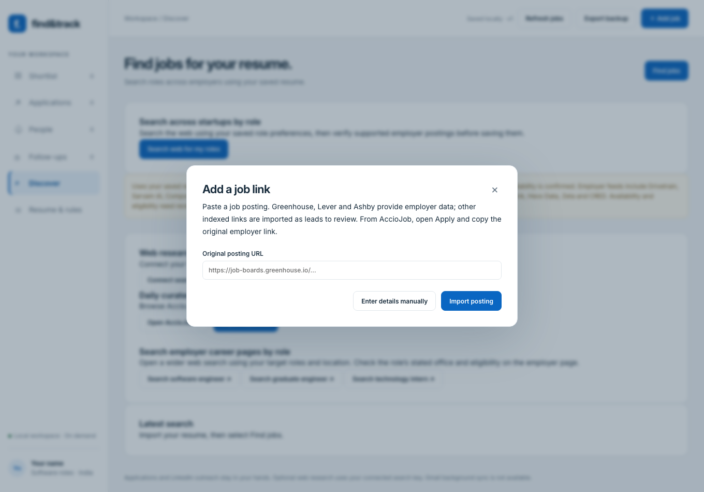

# Find&Track

A local-first, open-source workspace for finding software jobs and tracking what happens next.

I built this during my own job search in India: openings, resume versions, recruiter links and follow-ups were scattered across tabs. Find&Track brings that workflow into one workspace. **v0.4.0 is an early release**, focused on India and early-career software roles. Contributions and ideas are welcome.


## Start in five minutes

**You do not need ChatGPT Plus, Codex, Claude, Alan, or an AI assistant to use this app.** Install it once and run it yourself. The core app is free; optional web research uses your own Tavily account and its quota.

| You want to… | What you need |
| --- | --- |
| Import a resume, track applications, export backups | Python and this app |
| Refresh supported employer job feeds | An internet connection |
| Search the web for roles and research companies/people | Your own Tavily API key |
| Automatically monitor Gmail or send applications/messages | Not available in this release |

Tavily supplies search results. Find&Track handles matching, importing, filtering and tracking. Search results still need review; Tavily does not make the app an autonomous application service.

### 1. Install the prerequisites

- Install **Python 3.11 or newer** from [python.org](https://www.python.org/downloads/). On Windows, enable **Add Python to PATH** if the installer offers it.
- Install **Git** from [git-scm.com](https://git-scm.com/downloads).
- Use a modern browser. **Node.js, npm, Docker and a cloud account are not needed to run the app.**

Open **Terminal** on macOS/Linux, or **PowerShell** on Windows. Run commands one line at a time and wait for each to finish. If you just installed Python or Git, close and reopen your terminal first.

### 2. Download the project

```sh
git clone https://github.com/anubhav1450/find-and-track.git
cd find-and-track
```

**Without Git:** use GitHub's **Code → Download ZIP**, extract the ZIP, then open a terminal inside the extracted folder. That folder must contain `README.md` and `requirements.txt`. Skip the two commands above and continue below. Keep the folder somewhere permanent; it will also hold your private workspace.

### 3. Install and start

**macOS / Linux — Terminal:**

```sh
python3 --version
python3 -m venv .venv
.venv/bin/python -m pip install -r requirements.txt
.venv/bin/python outputs/find-track-app/launch.py
```

**Windows — PowerShell:**

```powershell
py --version
py -m venv .venv
.\.venv\Scripts\python.exe -m pip install -r requirements.txt
.\.venv\Scripts\python.exe outputs/find-track-app/launch.py
```

If Windows does not recognize `py` but `python --version` works, use `python` for the first two commands. The version must be 3.11 or newer. No environment activation command is necessary.

**Success looks like:** the terminal prints `Find&Track: http://127.0.0.1:8765` and opens your browser. If it does not open, visit [your local dashboard](http://127.0.0.1:8765/) yourself. This address works only on the computer where you started the app. No app signup is required.

Your first workspace is empty. That is expected—you are not loading the author's personal records.



### 4. Import your resume

1. Click **Resume & rules** in the left sidebar.
2. Click **Import resume** at the top.
3. Select a PDF, DOCX or TXT file under **3 MB**, then click **Read resume**.
4. Review the extracted text and click **Use this resume**. For a scanned PDF with no readable text, use **Or paste resume text** instead.
5. Check your name and master resume. Use **Save master resume** after editing them.





This release focuses on early-career software jobs in India. It does not yet provide a complete preferences editor for every occupation and country. Review screening results against your own eligibility.

### 5. Connect web search — optional

You can skip this and still use employer feeds and tracking.

1. Create your own account at [app.tavily.com](https://app.tavily.com/).
2. Copy an API key from your Tavily dashboard. Keep it private; do not paste it into an issue or public screenshot.
3. In Find&Track, open **Discover → Connect search**.
4. Paste the key into **API key**, then click **Save search key**.
5. Run **Search web for my roles** to check the connection. If the key is rejected, copy it again from your account and replace it.

Use Tavily's free plan and keep pay-as-you-go disabled if you want free-only usage. Check your provider dashboard for current credits. Every user supplies their own key; the author's key is not bundled.



### 6. Find jobs or import a link

**Discover jobs:** click **Refresh jobs** at the top. It checks supported employer feeds and, when connected, role-based web search. Read the source summary in **Discover**. Zero new jobs means no new matching records from those checked sources, not that the entire market has no vacancies.

**Already found a posting?** Click **Add job**, paste the original posting URL, and click **Import posting**. Review the imported details before saving. Supported employer URLs use public feeds; other indexed links can return incomplete details. If import fails, click **Enter details manually** in the dialog. Never treat an imported record as an application submission.



### 7. Apply and track

Open a job to review its description, resume gaps and company evidence. Company/people research needs the search key; it may return fewer than ten relevant contacts. Current employment, activity and company legitimacy need your review.

Open the original posting and apply there yourself. Return and tap **I applied**. Record your connection and message progress using the contact buttons; check **Follow-ups** for pending tasks. The app does not send LinkedIn requests, messages or applications for you, and Gmail background sync is not connected.

### Open it again tomorrow

Open a terminal in the same project folder and run **only the launch command**:

```sh
# macOS / Linux
.venv/bin/python outputs/find-track-app/launch.py
```

```powershell
# Windows
.\.venv\Scripts\python.exe outputs/find-track-app/launch.py
```

You do not need to reinstall dependencies each day. The launcher reuses an already running server. After a computer restart, run it again. Keep the project folder: local records live under `outputs/find-track-app/data/`.

Click **Export backup** regularly and before updating or moving computers. Keep that JSON private. On another installation, use **Resume & rules → Import / restore**; restoring replaces that installation's workspace.

### Common setup problems

| Problem | What to do |
| --- | --- |
| `python3`, `py` or `git` is not recognized | Install that prerequisite, reopen the terminal, and check its version. On Windows, try `python` if `py` is unavailable. |
| `requirements.txt` or `launch.py` cannot be found | Your terminal is in the wrong folder. Open it in the extracted/cloned project folder containing README.md. |
| Linux says `venv` or `ensurepip` is unavailable | Install your distribution's Python venv package, then repeat the environment creation step. |
| Browser says connection refused | Run the launch command and use the exact URL printed in the terminal. |
| Port 8765 is already occupied | Add `--port 8766` to your launch command and open the printed URL. |
| Resume extraction is blank | Use the paste-text option and check the content before saving. |
| Search key rejected / quota reached | Check your Tavily dashboard. Employer feeds and local tracking remain usable without web search. |
| Refresh adds zero jobs | Check Discover for source errors, filters and existing records; try importing a known posting URL. |
| Startup still fails | Check `outputs/find-track-app/data/server.log`. Report the error with your OS/Python version, removing personal data and credentials. |

The hosted owner workspace is not a public signup service. The instructions above create **your own independent local installation**.

## What works today

| Workflow | What to expect |
| --- | --- |
| Job discovery | Selected Greenhouse, Lever and Ashby employer feeds, Remotive, and optional role-based Tavily search |
| Freshness | Source publication dates separate from first discovery; current leads and date filters; source errors remain visible |
| Link import | Supported ATS postings read from public APIs; other indexed links are unconfirmed leads for review |
| Resume preparation | Keyword matches, gaps and evidence-based suggestions; reviewed checklist coverage is not an ATS score |
| Company research | Source-linked identity and concern checks, without a guarantee of legitimacy |
| People | Relevant recruiter/employee profile leads, deduplicated with source links; current employment/activity needs confirmation |
| Tracking | One-tap application/contact states, follow-up tasks, CSV export and JSON backup/restore |

Discovery does not cover every portal or guarantee new matches each day. Search-index timestamps are not proof of posting dates. Ten relevant people is a research target, not ten guaranteed active HR contacts. Gmail OAuth/background monitoring, automatic applications and automated LinkedIn outreach are not implemented.

## Optional search and privacy

Bring your own [Tavily](https://app.tavily.com/) key; provider free allowances and terms apply. Keep pay-as-you-go disabled if you want free-only usage. An uncached role search uses up to 3 basic searches, company research up to 12, and an unsupported posting lookup 1. Identical queries are cached for six hours.

The local app limits requests to 900 per UTC calendar month per key/cache installation. This is an attempted-request counter, not the provider's billing ledger. Other apps, deleted caches or separate installations can consume additional credits; ephemeral hosted caches cannot enforce an account-wide limit.

Resume files are processed locally. Search sends role/location preferences, company names or posting URLs to Tavily, not your full resume/contact details. Keys, resumes, databases and exported backups must remain private. See [security and data handling](SECURITY.md).

## Architecture

```text
Browser dashboard → Python HTTP API → local SQLite workspace
                         ├─ resume parser and matching rules
                         ├─ public employer feed adapters
                         └─ optional Tavily discovery/company research
```

Vanilla JavaScript keeps the UI lightweight. Python handles validation, imports, discovery and revision-aware persistence. The optional cloud adapter uses Supabase authentication/storage; it is an owner-only deployment. [Architecture](docs/ARCHITECTURE.md) · [App guide](outputs/find-track-app/README.md) · [Self-hosting](DEPLOYMENT.md)

## Help shape the project

[Report a bug or propose an idea](https://github.com/anubhav1450/find-and-track/issues/new/choose). Especially welcome: fresher-job matching, documented source adapters, accessibility, installation feedback and freshness verification. Use fictional fixtures and public job links; do not post your resume or API key.

[Contributing](CONTRIBUTING.md) · [Roadmap](docs/ROADMAP.md) · [Changelog](CHANGELOG.md) · [Discovery design](docs/DISCOVERY_V02.md)

MIT licensed; bundled Inter font is OFL licensed. [License](LICENSE) · [Font license](outputs/find-track-app/static/Inter-OFL.txt)
