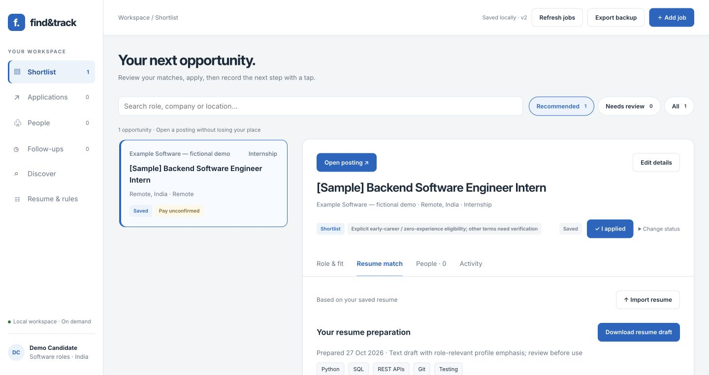

# Find&Track — submission notes

## The story

I started with a problem I experience as an early-career software candidate: scattered job discovery, repeated resume review and missed recruiter follow-ups. The first result is a personal assistant workspace with persistent application state. The next experiment packages its review-and-save workflow as an Alan skill.

## Review the work

- [Motivation, architecture, setup and limits](README.md)
- [Alan companion and reproducible local walkthrough](ALAN_COMPANION.md)
- [Skill instructions](skills/find-track/SKILL.md)
- [Local bridge](tools/findtrack.py)
- [Fictional sample fixtures](examples/alan-demo/)
- [Hosted architecture](DEPLOYMENT.md)

The screenshot uses a fictional sample profile and vacancy. The hosted deployment is a private personal workspace; use the local demo to review without an account.

## Demonstration integrity

The submission video shows actual app screenshots, an explanatory architecture diagram and a summary of verified local commands. The terminal panel summarizes local verification; it is not a recording of Alan executing commands. The skill was installed in Alan, but the model run was blocked by unavailable account allowance. Successful end-to-end Alan execution remains pending.

Automatic Gmail monitoring, universal portal coverage and automatic LinkedIn actions are not implemented or claimed. This is an open-source prototype in progress.
